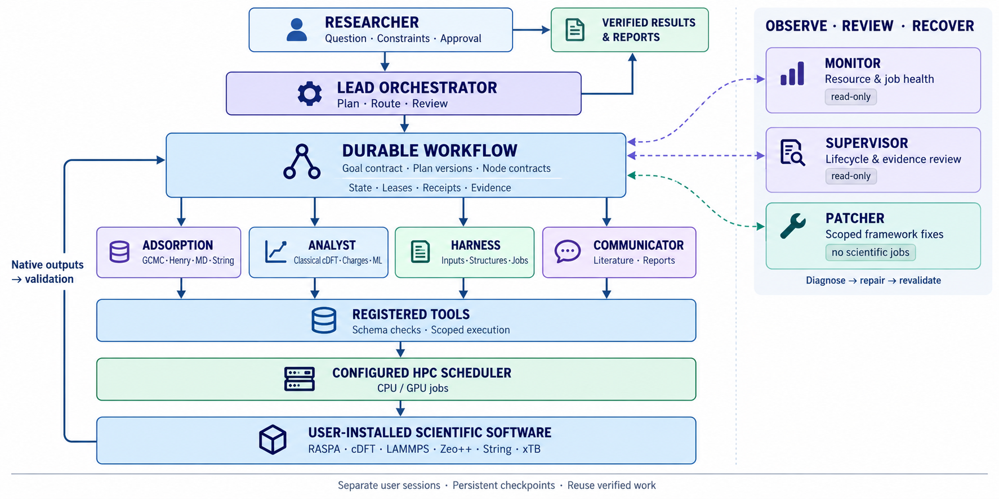

<div align="center">

# SEP-PILOT

### AI research copilot for molecular simulation

From a scientific question to an executable workflow, live progress, and traceable results — in one workspace.

[](https://github.com/Yong-Q/Sep-Pilot/releases/tag/v3.4.77)
[](https://www.python.org/)
[](#license)
[](#quality)

**[Features](#features) · [Scientific workflows](#scientific-workflows) · [Changelog](CHANGELOG.md) · [Quick start](#quick-start) · [License](#license)**

</div>

---

Sep-Pilot helps researchers plan, launch, follow, and review computational materials workflows through a conversational interface. Describe the research objective and the system turns it into a visible task graph, coordinates the required scientific programs, and keeps every result connected to its source.



## How the agents collaborate

Sep-Pilot separates research decisions, workflow execution, and evidence review. The lead orchestrator turns the user's objective into a versioned goal contract and a structured DAG. Every node records its agent, tool, arguments, dependencies, expected outputs, and resource locks before it can run.

| Role | Responsibility | Authority boundary |
|---|---|---|
| **Lead orchestrator** | Clarifies the objective, proposes the plan, routes work, and reviews evidence. | May coordinate registered tools through the workflow runtime; does not bypass the task graph. |
| **Adsorption specialists** | GCMC, Henry, framework MD, pore analysis, and String/TST workflows. | Produce domain outputs and evidence for their assigned nodes. |
| **Analyst specialists** | Classical cDFT, charges, binding energy, VASP, feature extraction, and ML preparation. | Consume declared inputs and publish structured results. |
| **Harness maintainer** | Creates inputs, checks structures and environments, and prepares scheduler jobs. | Owns setup and job plumbing, not scientific conclusions. |
| **Communicator** | Searches source-linked literature and assembles evidence-backed reports. | Keeps literature leads separate from calculation results. |
| **Monitor and supervisor** | Observe resources, scheduler state, lifecycle, and evidence completeness. | Read-only: they never submit, cancel, or mutate scientific jobs. |
| **Patcher** | Repairs framework code and runs focused checks after a diagnosed failure. | Cannot launch user calculations or alter user result files. |

The durable workflow store keeps goal versions, leases, attempts, scheduler receipts, artifacts, and evidence history. Independent branches can run in parallel while leases prevent conflicting writes. A `prefinish` result means that a tool returned and still needs evidence validation; only the current node and attempt can complete the workflow. Recoverable failures are diagnosed and repaired, while completed branches and their receipts remain available after an interruption.

Scientific programs stay outside the release. Deployment-specific paths are supplied through `config/runtime.json` or `BIMEM_RUNTIME_CONFIG`, so users can point MD and String workflows at their own LAMMPS, MPI, and String installations. The public source does not include scientific binaries, accounts, API keys, or private scheduler settings.

### 中文说明

主智能体负责澄清目标、生成并审核任务图；专业智能体分别处理吸附、MD、cDFT、结构和分析任务。所有任务都经过统一工作流运行时调度，节点带有依赖、资源锁、尝试记录、作业回执和证据。Monitor 与 Supervisor 只读监控，Patcher 只修复框架代码，不会替用户提交或修改科学计算。独立分支可以并行执行，中断后依靠持久化检查点继续，已完成结果不会被覆盖。

## Features

| | Feature | Experience |
|---|---|---|
| 🧭 | **Research planning** | Turn a natural-language objective into a clear, reviewable sequence of scientific tasks. |
| 🕸️ | **Visual workflow** | Follow dependencies, parallel branches, progress, and results in a persistent graph. |
| 🧪 | **Specialist agents** | Coordinate agents for structures, force fields, adsorption, molecular simulation, and data analysis. |
| 🖥️ | **HPC execution** | Launch and follow long-running calculations on a configured research cluster. |
| ♻️ | **Task recovery** | Continue interrupted work and handle recoverable failures without losing completed results. |
| 📝 | **Live reports** | Read evidence-backed report sections as workflow branches finish, then receive one updated final report. |
| 📦 | **Result handoff** | Feed structures, tables, trajectories, and other outputs into the next scientific task. |
| 🔎 | **Evidence tracking** | Keep calculations, files, scheduler receipts, and conclusions connected for later review. |
| 📚 | **Scientific knowledge** | Search source-linked guidance and relevant papers while keeping literature leads separate from verified results. |
| 🧠 | **Model planning** | Prepare reproducible training and active-learning workflows from documented datasets. |
| 👥 | **Session isolation** | Maintain separate goals, files, workflows, and history for each user session. |

## Scientific workflows

Sep-Pilot can coordinate workflows that include:

- MOF structure generation and CIF preparation
- pore geometry and accessible-volume analysis
- framework and guest charge assignment
- force-field discovery and inspection
- GCMC adsorption calculations and isotherms
- molecular dynamics preparation and execution
- diffusion and trajectory analysis
- adsorption-heat and cDFT workflows
- batch material screening and result comparison
- evidence-grounded scientific reports

Scientific programs are configured for each deployment. Sep-Pilot checks that required tools are available before starting a workflow.

## One workspace, full visibility

The web interface combines the research conversation with a live workflow view. Researchers can:

- review the proposed task graph before execution;
- inspect the inputs and outputs of every task;
- see queued, running, completed, paused, and failed work;
- follow cluster jobs without leaving the session;
- request a change while preserving completed results;
- return after an interruption and continue the same workflow;
- receive the final answer together with its calculation evidence.

## Quick start

### Backend

```bash
git clone https://github.com/Yong-Q/Sep-Pilot.git
cd Sep-Pilot

python -m venv .venv
source .venv/bin/activate
python -m pip install --upgrade pip
python -m pip install -e .

cp .env.example .env
# Add your model-provider settings to .env

set -a
source .env
set +a
uvicorn api:app --host 127.0.0.1 --port 8000
```

### Web interface

```bash
cd frontend
npm ci
npm start
```

Open `http://localhost:3000` and create a research session.

### Command line

```bash
python -m agents --list-agents
python -m agents -i
```

## Quality

Calculation paths use the existing local `config/runtime.json` (or
`BIMEM_RUNTIME_CONFIG` override). Install scientific software yourself; the
distribution contains Python adapters, not LAMMPS, MPI, GPU binaries, accounts,
or credentials. For example:

```json
{
  "paths": {"agent_env_python": "/opt/science-env/bin/python"},
  "software": {
    "lammps_executable": "/opt/lammps/bin/lmp_mpi",
    "mpi_executable": "/opt/mpi/bin/mpirun",
    "lammps_interface_executable": "/opt/science-env/bin/lammps-interface",
    "string_tst_executable": "/opt/string/bin/GPU_string_polyatmoic",
    "string_tst_generate_script": "/opt/string/generate_string_inputs.py"
  }
}
```

MD's Python environment needs ASE. If your installation requires extra dynamic
libraries, set `software.lammps_library_path`; existing library search paths are
preserved. Configuration changes apply to the next submission, and the selected
programs must also be accessible on compute nodes.

Release `v3.4.77` was validated with 647 backend tests passing, 31 optional integration tests skipped when site software was unavailable, frontend checks, production build validation, real MD/String smoke jobs, and a sanitized-export privacy scan.

Run backend checks with `python -m pytest tests -q`. Scientific integration checks that need the optional Towhee assets, guest force-field pipeline, RASPA binary, or CIF feature extractor are skipped when those dependencies are absent. Core configuration and scheduler command tests use isolated fixtures and do not require private site settings. A passing core suite does not validate calculations from unavailable scientific installations.

Run frontend checks with `cd frontend && npm ci && CI=true npm test -- --watch=false --runInBand`, then `npm run build`. The browser acceptance scripts use synthetic HTTP fixtures; their results cover UI interactions rather than physical calculations.

## License

Copyright © 2026 **Yong-Q**.

Sep-Pilot is source-available under the **[PolyForm Noncommercial License 1.0.0](LICENSE)**. Personal research, study, experimentation, education, and qualifying noncommercial institutional use are permitted under its terms. **Commercial use is not permitted without a separate license from the author.**

## Author

Created and maintained solely by **[Yong-Q](https://github.com/Yong-Q)**.

---

<div align="center">

**Ask · Plan · Run · Review**

</div>
